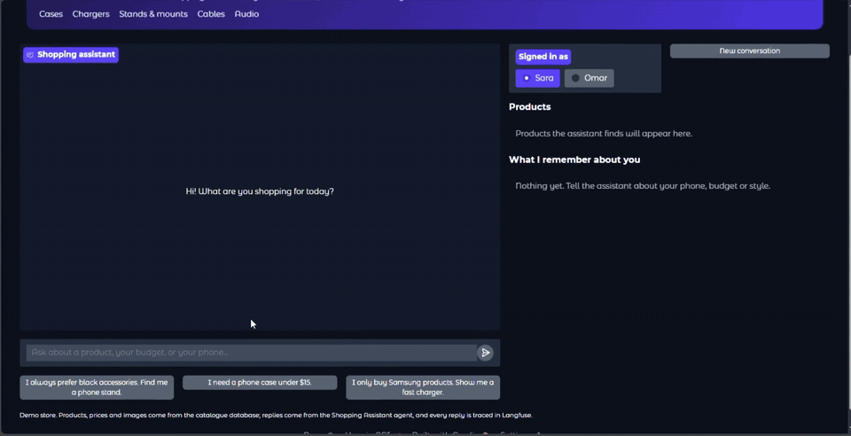
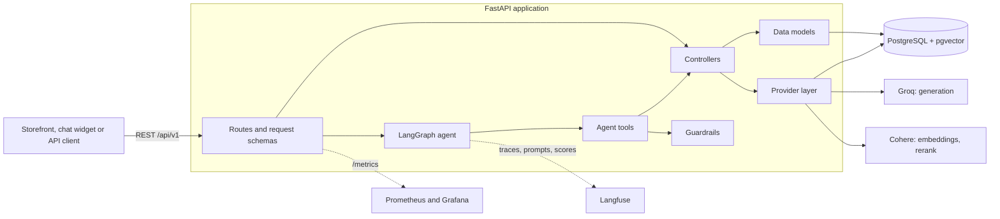

# Shopping Assistant

[](https://github.com/AhmedMostafa167/Shopping-Assistant/actions/workflows/CI.yml)
[](https://www.python.org/)
[](https://fastapi.tiangolo.com/)
[](https://langchain-ai.github.io/langgraph/)
[](https://github.com/pgvector/pgvector)
[](https://langfuse.com/)
[](https://prometheus.io/)
[](https://www.docker.com/)

A conversational shopping assistant for e-commerce catalogues. A customer describes what they want in plain language; an agent searches the store's catalogue with hybrid semantic and keyword search, respects their budget, remembers their lasting preferences across conversations, and answers only with products and prices that exist in the catalogue.

Behind the agent is a production-style backend: a layered, provider-agnostic FastAPI service on PostgreSQL and pgvector, with full LLM tracing, prompt management without redeploys, user feedback, service monitoring with Prometheus and Grafana, code-graded evaluation of retrieval and agent behaviour, and run-time guardrails. Every improvement was measured before and after, and recorded in the [improvement log](eval/IMPROVEMENT_LOG.md).

## Demo



The demo storefront: a customer's preference for black accessories is stored and used again in a new conversation. The [full demo video](docs/media/shopping-assistant-demo.mp4) (1:25) also shows a second customer who only buys Samsung, an updated fact when they switch phones, and a request for a brand the store does not carry. Waits for replies are shortened in the video.

## Highlights

| Area | What was done | Measured result |
| --- | --- | --- |
| Retrieval | Keyword and vector search fused with Reciprocal Rank Fusion, then reranked | Right product ranked first: 23% → **43%** with reranking; in the top 10: **72%** hybrid vs 56% keyword and 41% vector alone |
| Search speed | Whole 12,730-product catalogue embedded and indexed with HNSW | Median vector search **35 ms → 3.1 ms**, 99.7% of exact top-10 results kept |
| Agent quality | Prompt v2 evaluated as a candidate in Langfuse before promotion | Tasks passed in all 3 runs: **7 → 12 of 12**, with **29% fewer** paid searches |
| Search relevance | Price and rating limits moved inside hybrid search (prompt v3), found through the demo | Returned products of the kind asked for: **70% → 100%**, 15% fewer paid searches, no check regressed |
| Guardrails | Input limits and a memory-write guard, tested with hostile tasks, every decision traced in Langfuse | **0 of 21** legitimate facts refused, system prompt leaked in **0** runs; reworded instructions still get past the pattern filter (1 of 4 blocked), so the next step is measured |
| Monitoring | Prometheus metrics from the API, PostgreSQL and the host, with a provisioned Grafana dashboard | Traffic, chat latency p50/p95, error rate, database and host health on one screen at startup |
| Engineering | Typed layers, provider factories, migrations, resumable jobs, CI | 107 automated tests, run on every push |

An example turn, copied from an evaluation run (prompt v2):

> **Customer:** I always prefer black accessories. Find me a phone stand.
>
> **Agent** (calls `read_memory` → `write_memory` "User prefers black accessories" → `search_catalog` "black phone stand"):
>
> Here are a few black phone stands that match your preference:
>
> | # | Product | Price | Key Features |
> |---|---------|-------|--------------|
> | 1 | **Wansurs 2‑Pack Mini Phone Kickstand** | $4.99 | Foldable, invisible design, metal construction, great for desks |
> | 2 | **Heainaiyoo Foldable Cell Phone Stand** | $5.99 | Adjustable angle, black flower design, lightweight |
> | 3 | **Alloy Folding Magnetic Car Phone Holder** | Price not listed | 360° rotation, magnetic, black + silver color, ideal for car dashboards |

Stored facts are read at the start of every later conversation, so the next search for this customer already knows the preference.

## Architecture



A layered FastAPI service: routes validate input, a LangGraph agent decides which tools to call, controllers hold the business logic, and the LLM and vector-database clients sit behind interfaces created from configuration, so a provider can be swapped with one setting. Each chat turn reads the customer's stored facts, runs hybrid search within any price and rating limits, and replies only with catalogue products and prices.

## Documentation

| Page | What it covers |
| --- | --- |
| [Architecture and design](docs/architecture.md) | Layers, data model, a chat turn step by step, hybrid retrieval with its measured results, agent tools and long-term memory, engineering practices. |
| [Evaluation and guardrails](docs/evaluation.md) | Retrieval and agent evaluations, the code checks, prompt v1 → v2 → v3 results, guardrails and how they were tested with hostile input. |
| [Observability](docs/observability.md) | Langfuse tracing, prompt management without redeploys, user feedback, Prometheus and Grafana monitoring. |
| [Running, configuring and integrating](docs/running.md) | Local and Docker Compose setup, every setting, the demo storefront, API reference, catalogue ingestion, integrating with an online store. |
| [Improvement log](eval/IMPROVEMENT_LOG.md) | Every measured change: method, numbers, what they showed and the decision taken. |
| [Roadmap](docs/roadmap.md) | What is deliberately not done yet, and what comes next. |

## Quick start

Requirements: Python 3.12+ and [uv](https://docs.astral.sh/uv/) or Docker, a Cohere API key (embeddings and reranking) and a Groq API key (generation). Langfuse is optional.

```bash
# Full stack: API, PostgreSQL with pgvector, Nginx, Prometheus and Grafana
mkdir -p docker/env
cp .env.example docker/env/.env.app    # set POSTGRES_HOST=pgvector and the API keys
cp docker/env/.env.example.postgres docker/env/.env.postgres
cp docker/env/.env.example.postgres-exporter docker/env/.env.postgres-exporter
cp docker/env/.env.example.grafana docker/env/.env.grafana
docker compose -f docker/docker-compose.yml up --build -d
```

The API is then at <http://localhost:8000/api/v1/> with interactive documentation at `/docs`, and Grafana at <http://localhost:3000>. To run without Docker, load a catalogue, or start the Gradio storefront demo, see [Running, configuring and integrating](docs/running.md).

```bash
# Tests: no API key or database needed
uv run --group dev pytest -q
```

## Repository layout

```text
.
├── .github/workflows/CI.yml        Lint and test workflow
├── demo/                           Gradio storefront demo, a client of the API
├── docker/                         Compose stack, Nginx, Prometheus and the application image
├── docs/                           Architecture, evaluation, observability, running, roadmap and demo media
├── eval/                           Retrieval and agent evaluation, tasks, checks and the improvement log
├── scripts/                        Prompt seeding, publishing and promotion
├── src/
│   ├── agent/                      LangGraph graph, tools, prompts, memory and guardrails
│   ├── controllers/                Ingestion, embedding and retrieval logic
│   ├── helpers/                    Settings, logging and Langfuse setup
│   ├── models/                     Data access, SQLAlchemy schemas and Alembic migrations
│   ├── routes/                     FastAPI routes and request schemas
│   ├── stores/                     LLM and vector database providers
│   └── utils/                      Rank fusion and metrics
├── tests/                          Unit and integration-style tests with fakes
├── pyproject.toml, uv.lock         Dependencies, locked with uv
└── LICENSE
```

## What's next

- Authentication between the store and the API, rate limiting, and per-store separation of data.
- A trained prompt-injection classifier behind the pattern-based memory filter, which misses reworded instructions.
- An evaluation gate in CI that blocks a merge on a behaviour regression.
- A live check that every price in a reply exists in the tool results.

The full list is in the [roadmap](docs/roadmap.md).

## License

See [LICENSE](LICENSE).
