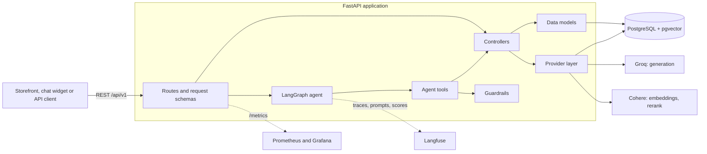
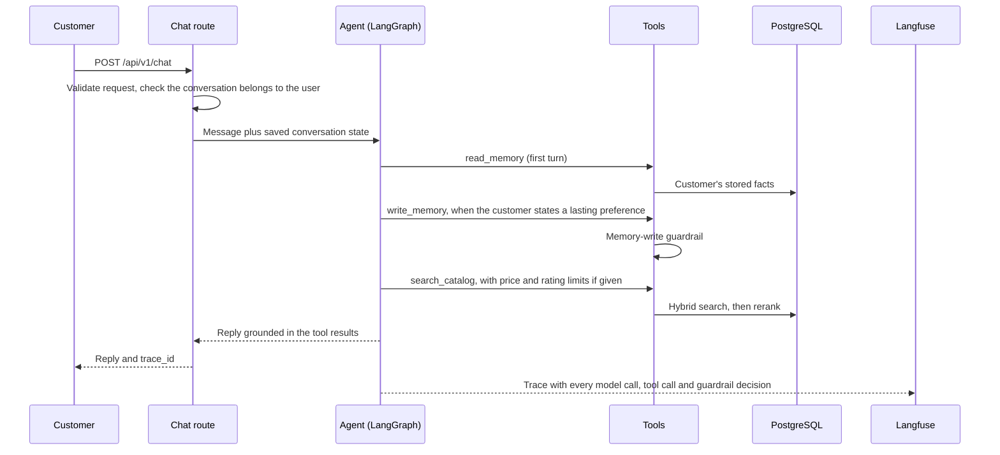
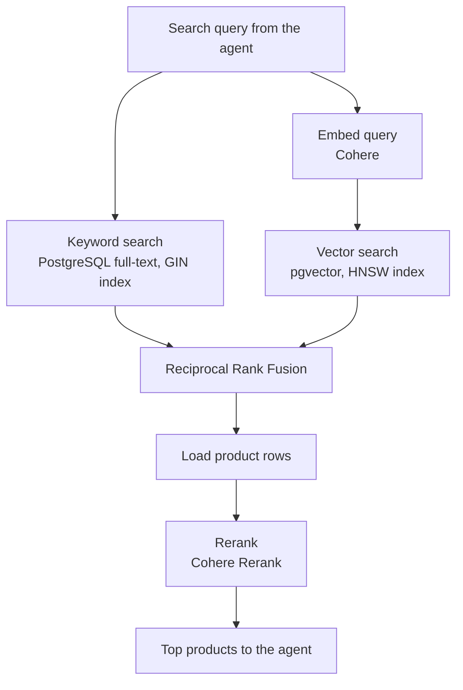

# Architecture and design

[Back to the README](../README.md)

## Architecture



The service is split into layers with one job each, so a new developer can find where a change belongs and replace one part without touching the others.

| Layer | Location | Responsibility |
| --- | --- | --- |
| Routes | `src/routes/` | HTTP endpoints. Requests and responses are Pydantic schemas, so invalid input is rejected before any work is done. |
| Controllers | `src/controllers/` | Business logic: ingestion, preprocessing, embedding, retrieval. |
| Data models | `src/models/` | One class per entity for database access, SQLAlchemy schemas and Alembic migrations. |
| Provider layer | `src/stores/` | LLM and vector database clients behind abstract interfaces, created by factories from configuration. |
| Agent | `src/agent/` | LangGraph graph, tools, prompts, memory controller and guardrails. |
| Helpers | `src/helpers/` | Settings validated at startup, structured logging, Langfuse client setup. |

### Built to be extended

| To add | Do this |
| --- | --- |
| A new generation or embedding provider | Implement `LLMInterface` in `src/stores/llm/providers/` and register it in `LLMProviderFactory`. Groq and Cohere are both implemented; the choice is one setting, `GENERATION_BACKEND`. |
| A new vector database | Implement `VectorDBInterface` and register it in `VectorDBProviderFactory`. |
| A new agent capability | Write a tool factory in `src/agent/tools.py` with a typed argument schema in `src/agent/schemas.py`, and add it to the graph. Dependencies are injected, so the tool is unit-tested with fakes. |
| A new product category | Upload a catalogue file for the category. Each category gets its own vector table and the same ingestion workflow. |
| A prompt change | Publish a new version in Langfuse under the `staging` label, evaluate it, then move the `production` label. No deploy is needed. |

### Catalogue data

The demo catalogue is 12,730 products from the Electronics and Cell Phones categories of the [Amazon Products 2023](https://huggingface.co/datasets/milistu/AMAZON-Products-2023-Arabic) dataset on Hugging Face, with titles, descriptions, prices, ratings, review counts and image URLs. `src/notebooks/data_preprocessing.ipynb` shows how the subset was selected.

### Data model

| Entity | Purpose |
| --- | --- |
| `categories` | Catalogue categories. |
| `assets` | Uploaded catalogue files and their category. |
| `products` | Title, description, price, rating, number of ratings, store and image, plus a generated full-text search column. |
| `profiles` | A customer, identified by username. |
| `memories` | Lasting facts about a customer: type, content, confidence. |
| `conversations` | Public conversation UUID, private LangGraph thread ID, owner and timestamps. |
| LangGraph checkpoint tables | Conversation state, so a conversation continues across requests and restarts. |
| `table_<dimension>_<category>` | One pgvector table per category with the product embeddings. |

## How a chat turn works



The agent decides which tools to use. The customer's identity is never a tool argument: it comes from the server-side request, so the model cannot read or change another customer's memory.

## Hybrid product retrieval



Keyword search finds exact model names and brands; vector search finds products described in different words. They succeed on different queries, so they are fused. Fusion alone ranks poorly, and reranking restores first-place accuracy:

| Mode | Queries | Right product first | In top 3 | Returned at all | Median time |
| --- | --- | --- | --- | --- | --- |
| Keyword only | 127 | 36% (28–45) | 47% | 56% (top 10) | 3 ms |
| Vector only | 127 | 15% (10–22) | 24% | 41% (top 10) | 190 ms |
| Hybrid (fused) | 127 | 24% (18–33) | 54% | 72% (top 10) | 190 ms |
| Hybrid + rerank | 40 | 43% (29–58) | 60% | 60% (top 3) | 457 ms |

Results from 2026-10-11 with 95% confidence intervals. Reranking is billed per search, so it was measured on a fixed 40-query subset; on those 40 queries plain hybrid search scores 23% first and 50% in the top 3. Almost all of the search time is the embedding API call; the indexed database lookup takes about 3 ms.

Price and rating limits ("a case under $15, rated above 4.5") are applied inside both searches, before ranking, so only products within them are ranked; pgvector's iterative index scan keeps a filtered vector search returning a full set of results. An earlier design sent limits to a separate filter tool with no search query, which returned any products under the price, relevant or not; the demo exposed it and [entry 8 of the improvement log](../eval/IMPROVEMENT_LOG.md) measures the fix.

## Agent and long-term memory

The agent is a LangGraph graph with three tools:

| Tool | Purpose |
| --- | --- |
| `search_catalog` | Hybrid search with reranking, optionally within price and rating limits. |
| `read_memory` | The customer's stored facts, highest confidence first. |
| `write_memory` | Add a fact, or modify an existing one by its ID instead of adding a duplicate. |

Facts have a type (`preference`, `constraint` or `history`) and a confidence. The prompt separates lasting facts ("I only buy Samsung") from one-off requests ("a case under $15 for this purchase"), which are not stored; evaluation showed the first prompt version getting this wrong, and the second fixing it.

Tool output is written for the model to use correctly: a missing price is shown as "price not listed", and the score is labelled as a recommendation score adjusted for the number of reviews, not as the average rating.

## Engineering practices

- **Typed boundaries.** Requests, tool arguments and settings are Pydantic models; invalid input fails at the boundary with a clear error.
- **Configuration validated at startup.** Missing settings, or tracing enabled without keys, stop the application at startup instead of failing on the first request.
- **Migrations.** The schema is versioned with Alembic; the Docker image applies migrations before starting.
- **Resumable long jobs.** Catalogue embedding works in saved batches of 96, so an interrupted run loses at most one batch and the next call continues. Evaluations resume from saved runs.
- **Rate-limit handling.** The Cohere embedding client respects the 96-inputs-per-request and 2,000-inputs-per-minute limits, retries `429` responses and honours `Retry-After`.
- **Structured logging.** Events are logged as key-value records with `structlog`.
- **Monitoring.** Prometheus scrapes the API, PostgreSQL and the host; a provisioned Grafana dashboard shows traffic, latency, errors and resource use.
- **Tests and CI.** 104 tests run with fakes for every external service, so no API key or database is needed. They cover hybrid retrieval and rank fusion, reranking and embedding rate limits, embedding and indexing, the chat and feedback routes, prompt loading, publishing and promotion, tracing, the evaluation checks and metrics, and the guardrails. GitHub Actions runs a lint step for syntax errors, undefined names and unused variables, then the full test suite, on every push and pull request to `main`.

```bash
uv run --group dev pytest -q
```

## Implementation notes

- **Identity:** `username` is the identity boundary; authentication is not implemented.
- **Vector dimensions:** the vector column dimension comes from `EMBEDDING_MODEL_SIZE`; changing it requires new tables and re-embedding.
- **Category tables:** embeddings live in `table_<dimension>_<category>`. If product titles or descriptions change, re-run embedding for that category.
- **Reranking fallback:** without a reranking client, the fused order is kept.
- **Model prices:** Langfuse computes cost from token counts; a model missing from its price list needs a price added under Settings → Models.
