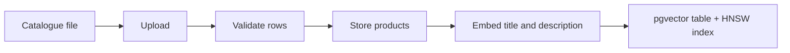

# Running, configuring and integrating

[Back to the README](../README.md)

## Getting started

### Requirements

- Python 3.12+ and [uv](https://docs.astral.sh/uv/), or Docker.
- PostgreSQL with the `vector` extension, or the pgvector Docker image.
- A Cohere API key (embeddings and reranking) and a Groq API key (generation), or Cohere for generation as well.
- Optional: a Langfuse project for tracing, prompts and experiments.

### Run locally

```bash
# 1. Install dependencies
uv sync --group dev

# 2. Configure
cp .env.example .env    # add database, Cohere, Groq and optional Langfuse settings

# 3. Start PostgreSQL with pgvector
docker run --name shopping-assistant-pgvector \
  -e POSTGRES_USER=postgres -e POSTGRES_PASSWORD=postgres -e POSTGRES_DB=shopping_assistant \
  -p 5432:5432 -d pgvector/pgvector:0.8.6-pg18-trixie

# 4. Run migrations (set sqlalchemy.url in the copied alembic.ini first)
cp docker/shopping_assistant/alembic.example.ini src/models/db_schemes/shopping_assistant/alembic.ini
(cd src/models/db_schemes/shopping_assistant && uv run alembic upgrade head)

# 5. Start the API
uv run uvicorn --app-dir src main:app --reload --host 0.0.0.0 --port 8000
```

The API is then at <http://localhost:8000/api/v1/>, with interactive documentation at <http://localhost:8000/docs> and metrics at <http://localhost:8000/metrics>.

### Run with Docker Compose

| Service | Purpose | Port |
| --- | --- | ---: |
| `fastapi` | Shopping Assistant API | `8000` |
| `nginx` | Reverse proxy | `80` |
| `pgvector` | PostgreSQL with pgvector | `5432` |
| `prometheus` | Metrics collection | `9090` |
| `grafana` | Dashboards | `3000` |
| `postgres-exporter` | PostgreSQL metrics | `9187` |
| `node-exporter` | Host metrics | `9100` |

Compose expects environment files under `docker/env/` (`.env.app`, `.env.postgres`, `.env.postgres-exporter`, `.env.grafana`). They hold credentials and are not committed; templates are in `docker/env/`.

```bash
mkdir -p docker/env
cp .env.example docker/env/.env.app    # set POSTGRES_HOST=pgvector and the API keys
docker compose -f docker/docker-compose.yml up --build -d
```

The image runs `alembic upgrade head` before starting Uvicorn. `docker compose -f docker/docker-compose.yml down -v` also deletes the database, asset, Prometheus and Grafana volumes; use it only when data loss is acceptable.

## Configuration

The application reads `.env` through `pydantic-settings`; `.env.example` lists every variable.

| Variable | Required | Description | Example |
| --- | --- | --- | --- |
| `APP_NAME` | Yes | Application name. | `shopping_assistant` |
| `APP_VERSION` | Yes | Version, also attached to traces. | `0.1.0` |
| `POSTGRES_USERNAME`, `POSTGRES_PASSWORD` | Yes | Database credentials. | `postgres` |
| `POSTGRES_DB` | Yes | Application database. | `shopping_assistant` |
| `POSTGRES_HOST`, `POSTGRES_PORT` | Yes | `localhost` locally, `pgvector` in Compose. | `localhost`, `5432` |
| `POSTGRES_MAIN_DATABASE` | Yes | Main PostgreSQL database setting. | `postgres` |
| `VECTOR_DB_BACKEND` | Yes | Vector database provider. | `pgvector` |
| `LLM_BACKEND` | Yes | Provider for embeddings and reranking. | `CoHere` |
| `COHERE_API_KEY` | Yes | Cohere API key. | |
| `EMBEDDING_MODEL`, `EMBEDDING_MODEL_SIZE` | Yes | Embedding model and its vector dimension; the dimension must match the vector tables. | `embed-english-v3.0`, `1024` |
| `RERANKING_MODEL` | Yes | Cohere reranking model. | `rerank-v4.0-pro` |
| `GENERATION_BACKEND` | No | `GROQ` or `COHERE`; defaults to `COHERE`. | `GROQ` |
| `GROQ_API_KEY` | With Groq | Groq API key. | |
| `GENERATION_MODEL` | Yes | Chat model for the agent. | `openai/gpt-oss-20b` |
| `DEFAULT_GENERATION_MAX_OUTPUT_TOKENS` | Yes | Reply length cap. | `1000` |
| `DEFAULT_GENERATION_TEMPERATURE` | Yes | Generation temperature. | `0.1` |
| `DEFAULT_INPUT_MAX_CHARACTERS` | Yes | Input cap for the provider's single-prompt calls. | `1000` |
| `FILE_ALLOWED_TYPES`, `FILE_ALLOWED_SIZE` | Yes | Accepted upload types and size. | |
| `LANGFUSE_TRACING_ENABLED` | No | Turn tracing on. | `false` |
| `LANGFUSE_PUBLIC_KEY`, `LANGFUSE_SECRET_KEY`, `LANGFUSE_BASE_URL` | With tracing | Langfuse project keys and region. | |
| `LANGFUSE_PROMPT_LABEL` | No | Which prompt versions to serve. | `production` |

Never commit `.env` or API keys.

## Demo storefront

`demo/app.py` is a Gradio storefront for a fictional phone-accessories shop, built as a plain HTTP client of the API, the way a real store's website would integrate:

- A chat with the assistant, with example questions to start from.
- Product cards with the catalogue image, price and recommendation score for every product the agent found.
- A customer switcher and a "What I remember about you" panel, to show preferences carrying over to a new conversation.
- 👍/👎 on each reply, recorded in Langfuse as user feedback on that reply's trace.

```bash
# Terminal 1: the API
uv run uvicorn main:app --app-dir src --port 8001

# Terminal 2: the storefront, at http://localhost:7860
uv run --group demo python demo/app.py
```

Set `SHOPPING_API_URL` if the API runs elsewhere.

## API reference

All application routes are under `/api/v1`. Interactive documentation is served at `/docs`.

| Method | Path | Purpose |
| --- | --- | --- |
| `GET` | `/api/v1/` | Application name and version. |
| `POST` | `/api/v1/conversations` | Create a conversation for a username. |
| `POST` | `/api/v1/chat` | Send a message; returns the reply, its `trace_id` and the products found as cards. |
| `GET` | `/api/v1/profiles/{username}/memories` | The customer's stored facts. |
| `POST` | `/api/v1/chat/feedback` | Rate a reply. |
| `POST` | `/api/v1/data/upload/{category}` | Upload a catalogue file. |
| `POST` | `/api/v1/data/validate/{asset}` | Validate an uploaded file. |
| `POST` | `/api/v1/data/store/{asset}` | Store validated products. |
| `POST` | `/api/v1/data/embed/{category}` | Embed and index products that have no embedding yet. |
| `POST` | `/api/v1/data/retrieve/{category}` | Run hybrid search directly. |
| `GET` | `/metrics` | Prometheus metrics. |

### Chat

```bash
# Create a conversation
curl -X POST http://localhost:8000/api/v1/conversations \
  -H 'Content-Type: application/json' \
  -d '{"username": "alice", "title": "Phone shopping"}'

# Send a message
curl -X POST http://localhost:8000/api/v1/chat \
  -H 'Content-Type: application/json' \
  -d '{
    "username": "alice",
    "conversation_id": "<conversation_id from the previous response>",
    "message": "Find me a phone case under $15"
  }'
```

The conversation must belong to the given username. Messages over 2,000 characters are rejected with `422`. The response includes a `trace_id` when tracing is enabled, and `products`: the products the agent's tools returned in this turn, each with `product_id`, `title`, `price` (`null` when not listed), `recommendation_score` and `image`.

### Feedback

```bash
curl -X POST http://localhost:8000/api/v1/chat/feedback \
  -H 'Content-Type: application/json' \
  -d '{
    "username": "alice",
    "conversation_id": "<conversation_id>",
    "trace_id": "<trace_id from the chat response>",
    "helpful": false,
    "comment": "It ignored my budget."
  }'
```

The rating is stored in Langfuse as a `response_rating` score (1 helpful, 0 not) on the reply's trace; rating again replaces it. Returns `202` when accepted and `503` when tracing is disabled. It does not yet verify that the trace belongs to the conversation.

### Direct retrieval

```bash
curl -X POST \
  'http://localhost:8000/api/v1/data/retrieve/electronics_cellphones?query=wireless%20noise%20cancelling%20headphones'
```

Runs hybrid search with reranking and returns product rows as JSON, with `NaN` values converted to `null`.

## Catalogue ingestion



```bash
curl -X POST http://localhost:8000/api/v1/data/upload/electronics_cellphones -F 'file=@./catalog.csv;type=text/csv'
curl -X POST http://localhost:8000/api/v1/data/validate/<asset_name>
curl -X POST http://localhost:8000/api/v1/data/store/<asset_name> -H 'Content-Type: application/json' -d '{"batch_size": 100}'
curl -X POST http://localhost:8000/api/v1/data/embed/electronics_cellphones
```

Each row is validated against this shape:

| Field | Type | Required | Notes |
| --- | --- | --- | --- |
| `parent_asin` | string | Yes | Source catalogue identifier. |
| `title` | string | Yes | Product title. |
| `description` | string | Yes | Product description. |
| `filename` | string | Yes | Required by the current validation model. |
| `store` | string | No | Seller or brand. |
| `average_rating` | float | No | Defaults to `0.0`. |
| `rating_number` | integer | No | Defaults to `0`. |
| `price` | float | No | Defaults to `0.0`. |
| `image` | string | No | Image URL. |

Loaders are chosen by extension: `.csv`, `.xlsx`/`.xls`, `.json`, `.parquet` (pandas) and Arrow IPC (PyArrow). The upload MIME type must be listed in `FILE_ALLOWED_TYPES`.

The embed endpoint embeds every product in the category without an embedding, in batches of 96, saving each batch before the next. It is safe to call repeatedly; `?max_products=N` caps one call and `?max_products=0` only reports how many remain. When the vector table reaches 1,000 rows it builds an HNSW index for cosine distance; later inserts are indexed automatically.

## Integrating with an e-commerce platform

The service is built to sit behind an online store as its product-discovery assistant:

1. **Load the catalogue.** Upload the store's product export (CSV, Excel, JSON, Parquet or Arrow) per category through the data API, validate it, store it and embed it. Embedding is resumable, so large catalogues can be loaded in several calls.
2. **Add the chat to the storefront.** A chat widget calls two endpoints: create a conversation, then send messages. Each reply comes with the products the agent found as structured cards (ID, title, price, recommendation score, image URL), taken straight from the catalogue rather than from the model's text, so the widget can render them reliably.
3. **Remember customers.** Passing the store's customer ID as the username gives each shopper lasting memory of their preferences, budget and devices across visits.
4. **Operate it.** Every conversation is traced, customers can rate replies, prompts change without a deploy, and request metrics feed Prometheus and Grafana.

What a store gets: customers can ask in their own words ("a stand for my desk, black, cheap"), get answers limited to products the store actually sells at their real prices, and are not asked for their preferences again on every visit.

Before running it for real customers, a platform integration would add: authentication between the store and this API, separation of catalogues and customers per store, rate limiting, product links and add-to-cart on the cards, catalogue sync through the platform's product API, and customer-facing controls to delete stored memory.
